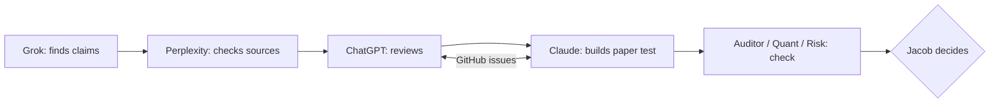

# 🤝 Team Overview

| | Member | Role | Status |
|---|---|---|---|
| 👑 | [[Jacob]] | Founder | Human |
| 🛠️ | [[Claude]] | Lead Developer | Active, verified |
| 🧭 | [[ChatGPT]] | Research Director | Active, verified (when Jacob opens a session) |
| 🔭 | [[Grok]] | Strategy Scout | Manual, not automated |
| 🔎 | [[Perplexity]] | Fact-Checker | Manual, not automated |
| ♊ | [[Gemini]] | Independent Reviewer | Not active yet (free GEMINI_API_KEY not set) |
| 🧮 | [[Data Auditor]] | Data integrity | Active, tested |
| 📐 | [[Quant Analyst]] | Statistics | Active, tested |
| 🛡️ | [[Risk Sentinel]] | Safety | Active, tested |
| 📡 | [[Polybot HQ relay]] | Messenger | Active, tested |

## How work flows

Profiles are auto-generated. Add your own notes in a new file.

---
*Auto-generated from GitHub by `vault_sync.py`. Edits here are overwritten; write your own notes in a new file.*
